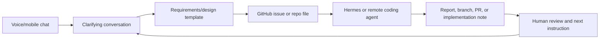

# Handoff: Voice Chat To Program Design

Created: 2026-08-23  
Repo location: `/Users/s_admin/Documents/agent_set_up/repos/video2notes-v2`  
Audience: a Claude Code or Codex session resuming local work with access to the `video2notes-v2` checkout.

## Purpose

This handoff preserves the project thread about turning voice/mobile chat into program design work.

Do not conflate this with the research/learn/teach system. This project is about capturing rough spoken intent, refining it into a requirements or design artifact, and handing that artifact to an implementation agent through GitHub or a similar durable work queue.

## Project Boundary

This thread is about:

- A voice or mobile chat where Curtis can talk through a software idea while driving, walking, or going to sleep.
- A refinement pass that converts the messy conversation into a templated requirements/design document.
- A GitHub handoff path where the document becomes an issue, file, or task that Hermes or another worker can pull.
- A remote coding/reporting agent that can then implement, investigate, or produce a report.

This thread is not about:

- Teaching Curtis a topic.
- Generating study notes, retrieval practice, spaced review, or teach-back plans.
- The `with-learning-science` skill, except as an example of how handoffs and skills can preserve process.
- The internal learning pipeline phases for video/course material.

## Relevant Cloud Sessions

These sessions were visible through the signed-in Claude cloud UI in Chrome.

| Session | URL | Why It Matters |
| --- | --- | --- |
| `Appearance and aesthetics` | `https://claude.ai/chat/00245818-8b05-47ba-a827-3153ba99dbed` | Main source for the voice-chat-to-design workflow. Messages 5-12 discuss wanting voice chat to become a requirements document and then land in GitHub for Hermes/agents. |
| `human training loop discussion in car` | `https://claude.ai/chat/1b94aaf5-9a68-48d7-aaa0-67b1f9f820b3` | Confirms the distinction between ordinary voice chat and the remote code session. Also shows the GitHub issue handoff pattern around video-to-notes tracer-bullet work. |
| `Fix video fragment sorting and context management` | `https://claude.ai/code/session_01BS2oPoZytacDJNV6jRDuTc` | Newer Claude Code context. Mostly belongs to the learning/video2notes thread, but it shows the active local/code surface that future work may resume from. |

## What The Voice Chat Established

The user goal was not "make notes." The goal was an operating pattern:

1. Talk through a project idea conversationally.
2. Let the assistant ask clarifying questions and tighten the idea.
3. Produce a durable requirements/design document.
4. Put that document somewhere a coding agent can poll or read.
5. Let the coding agent start work while Curtis is away from the keyboard.

The voice chat described a possible current setup:

- A Hermes agent has a cron-like polling pattern.
- The poll target may be a GitHub repo or issue queue.
- The worker can initially produce reports and eventually code directly when permissions are right.
- The desired front end is the comfortable voice/chat interface, not a terminal-first workflow.

## Product Shape

The useful design skeleton is:



## Candidate Requirements Document Template

The design chat did not finalize a template, but the next session should start with something close to this:

```markdown
# Task Design Brief

## Source Conversation

- Origin:
- Date:
- Context:

## Problem

What is broken, missing, confusing, or desired?

## Desired Outcome

What should exist after the agent finishes?

## Scope

In:

Out:

## Current System Clues

Repos, files, commands, screenshots, or prior sessions mentioned.

## Constraints

Permissions, credentials, timing, cost, safety, platforms, dependencies.

## Acceptance Criteria

- [ ] Observable result 1
- [ ] Observable result 2
- [ ] Tests or verification steps

## Suggested First Step

The smallest tracer-bullet action that proves the path works.

## Open Questions

Questions the worker should answer before broad implementation.
```

## Handoff Guidance For A Claude Code Session

When resuming this project in Claude Code:

1. Keep this thread separate from the learning-system thread.
2. Search local repos for Hermes, GitHub issue templates, polling jobs, and any existing task-design docs before inventing a new system.
3. Identify the real handoff channel before writing integration code: GitHub issue, repo file, Discord, local queue, or Hermes database.
4. Implement a tracer-bullet path first: one voice-derived task becomes one durable artifact that one worker can see.
5. Do not overbuild a full product UI until the handoff loop is proven end to end.

Useful prompt for a future code session:

```text
Resume the Voice Chat To Program Design thread. Do not work on the learning-system pipeline. Read handoffs/2026-08-23-voice-chat-to-program-design-handoff.md, search this machine for Hermes/GitHub task handoff docs, and propose the smallest tracer-bullet path where a voice-derived requirements brief becomes a GitHub issue or repo file that a worker can poll.
```

## How The Context Was Retrieved

This was not actual mind reading. The context came from browser-accessible cloud history and local files.

Tools and surfaces used:

- `browser:control-in-app-browser` skill was read to choose the right browser-control surface.
- `chrome:control-chrome` skill was read because the task depended on signed-in browser state.
- `plugin-management` skill and `tool_search` were used to check whether a direct ChatGPT/cloud-history connector existed. No direct ChatGPT history connector was exposed.
- `mcp__node_repl.js` controlled the browser runtime.
- Browser APIs used included:
  - `agent.browsers.list()`
  - `agent.browsers.getForUrl("https://chatgpt.com/")`
  - `browser.user.openTabs()`
  - `browser.user.history(...)`
  - `browser.tabs.new()`
  - `tab.goto(...)`
  - `tab.playwright.domSnapshot()`
  - Claude's visible search dialog through Playwright locators.

Observed browser/account state:

- Two Chrome profiles were available.
- Both profiles opened ChatGPT logged out, so ChatGPT cloud history was not accessible.
- The second Chrome profile had a signed-in Claude session.
- Claude's sidebar and search UI exposed cloud chats and Claude Code sessions.
- Searches included `with learning science`, `human training loop`, `human learning`, `learning science`, `base_human_learn_sys`, `video2notes`, and `learning skill`.

Safety boundary:

- I did not inspect cookies, local storage, passwords, or session stores.
- I did not send messages, submit forms, or modify the cloud sessions.
- I read visible page state and search results only.

## Cautions

- The Claude URLs require the signed-in account that owns those conversations.
- The visible Claude chat may load only slices of long conversations. The cited message ranges are based on what was visible after loading earlier/later sections.
- Some voice transcript text contains recognition errors, so preserve meaning but verify exact technical names before implementation.

